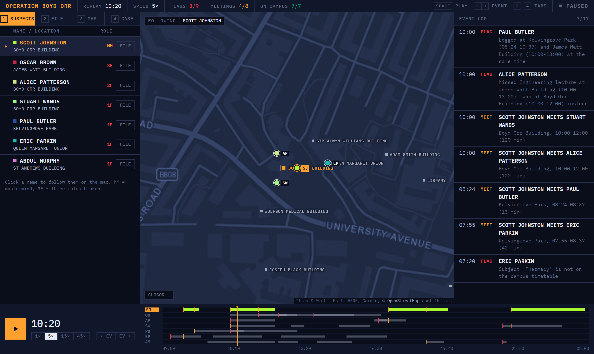

# Operation Boyd Orr

> Of 163 students, 6 broke campus rules on the day. One student broke none, yet met every one of them.

An investigation into the SAS challenge dataset for GUTS 2026. Rule-based checks run over the campus security logs to flag rule-breakers. A co-location search then finds the clean-record student who met all of them. The day is replayed on an interactive map.



---

## Contents
- [Findings](#findings)
- [How it works](#how-it-works)
- [Getting started](#getting-started)
- [Using the console](#using-the-console)
- [Project structure](#project-structure)
- [Data notes](#data-notes)
- [Limitations](#limitations)
- [Team](#team)

---

## Findings

| Role | Name | Why |
|---|---|---|
| **Mastermind** | Scott Johnston | Clean record, but met all 6 conspirators during the day |
| Conspirator | Oscar Brown | Logged in two buildings at once, three times |
| Conspirator | Alice Patterson | Missed her Engineering lecture; in two places at once |
| Conspirator | Stuart Wands | Entered The Hive aged 17 |
| Conspirator | Paul Butler | Logged in two buildings at once |
| Conspirator | Eric Parkin | Subject (Pharmacy) is not on the campus timetable |
| Conspirator | Abdul Murphy | In Boyd Orr Building after closing time |

The full evidence is in the **Case** tab of the console, under *Full case summary*.

---

## How it works

```
CSV files ──► data_loader ──► anomaly_detection ──► mastermind ──► build_website ──► index.html
              (clean, join)   (who broke rules?)    (who met them all?)
```

1. **`data_loader.py`** turns times into minutes after midnight, handles intervals that cross midnight, fixes known data errors, and joins the logs with student and building data.
2. **`anomaly_detection.py`** checks every student against four rules:
   - attended their degree's mandatory lecture
   - inside buildings only while they were open
   - aged 18 or over in age-restricted venues
   - never logged in two places at once
3. **`mastermind.py`** compares each clean student's visits with each conspirator's visits. Two visits count as a meeting when they are in the same building and their times overlap. The mastermind is the clean student who met *all* the conspirators.
4. **`build_website.py`** packs the results into `site_template.html` as JSON and writes `index.html`. It also fetches the walking routes between buildings once and caches them, so people's dots follow real footpaths.

---

## Getting started

### Requirements
- Python 3.10+ (developed on 3.14)
- pandas

```bash
pip install pandas
```

### Build and open
```bash
python build_website.py   # writes index.html
```
Then open `index.html` in a browser. No server is needed.

The first build fetches walking routes from OpenStreetMap's public walking-route service and saves them to `routes_cache.json`. Later builds work offline. If the service is unreachable, those walks are drawn as straight lines.

### Run each stage on its own
```bash
python data_loader.py         # row counts and unmatched logs
python anomaly_detection.py   # every flagged student and why
python mastermind.py          # clean students ranked by conspirators met
```

---

## Using the console

| Key | Action |
|---|---|
| `Space` | Play / pause |
| `←` `→` | Previous / next event |
| `1`–`4` | Suspects / File / Map / Case tabs |
| `F` | Follow the person whose file is open |
| `B` | Fly to Boyd Orr Building |
| `A` | Fit all suspects in view |
| `Esc` | Stop following |

- **Timeline strip:** one row per person, showing time on campus, red ticks for flags and amber ticks for meetings. Click or drag anywhere on it to scrub.
- **Event log:** click an entry to jump to that moment on the map.
- **File tab:** the student record, societies, rules broken, meetings and movements.

---

## Project structure

```
├── data_loader.py              # load, clean and join the CSVs
├── anomaly_detection.py        # rule-based audit (4 rules)
├── mastermind.py               # co-location search for the mastermind
├── build_website.py            # runs the pipeline, writes index.html
├── site_template.html          # front end; data is injected at /*CASE_DATA*/
├── index.html                  # generated, do not edit by hand
├── routes_cache.json           # cached walking routes
├── assets/                     # Leaflet (map library)
└── SAS_GUTS_HACKATHON_2026/    # challenge data
    ├── people_data.csv
    ├── security_logs.csv
    ├── location_data.csv
    └── student_statements.txt
```

---

## Data notes

Data errors found in the dataset and how they're handled:

| Issue | Fix |
|---|---|
| `Queen Maragret Building` (typo) in the security logs | Mapped to `Queen Margaret Union` |
| Jonny Craig logged as `2912324G` | Corrected to `2712324G` to match his student record |
| Some society lists use `{…}` instead of `[…]` | Both formats parsed |
| Opening times of `0000-0000` | Treated as open 24 hours |
| Visits crossing midnight (e.g. `2330-0115`) | 24 hours added to the end time |

Three students have the `{…}` society format: Scott Johnston, Alice Patterson and Russell Dixon. <!-- TODO: say whether this turned out to be a clue -->

---

## Limitations
- Two-places-at-once is only checked between visits that are next to each other in time order.
- Any overlap counts as a meeting, even one minute; there is no minimum duration.
- Data fixes are hard-coded for this dataset.
- Dots walk at a steady pace for the whole gap between two logged visits.

---

## Team
<!-- TODO: names, roles, links -->
- Shubh Shukla: Data Engineer
- Kanha Gorania: Data Analyst
- Neha Rajanala: UI Designer
- Anjini Jagwani: UI Designer

## Acknowledgements
- Challenge and data: SAS at GUTS 2026
- Map tiles: © Esri; walking routes and map data © OpenStreetMap contributors
- [Leaflet](https://leafletjs.com/) for the map
